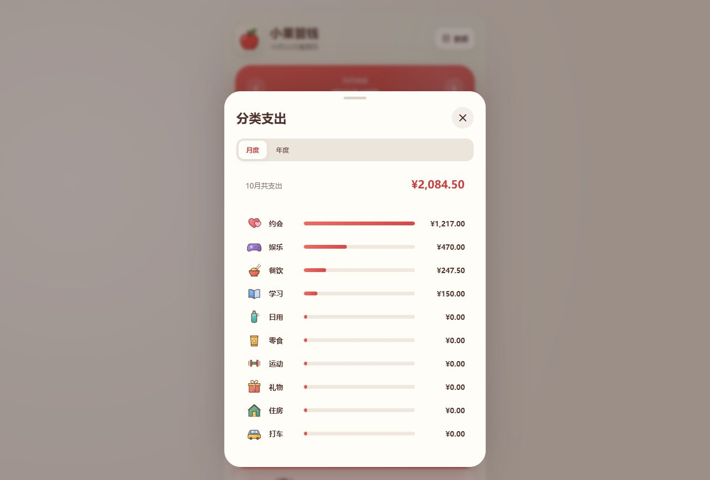
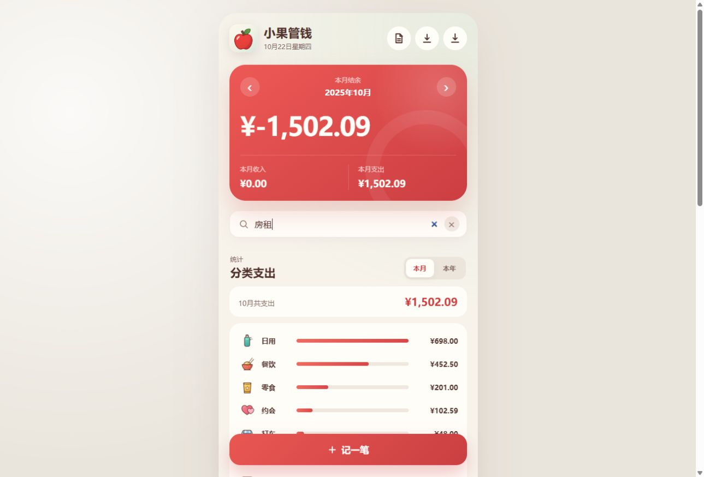
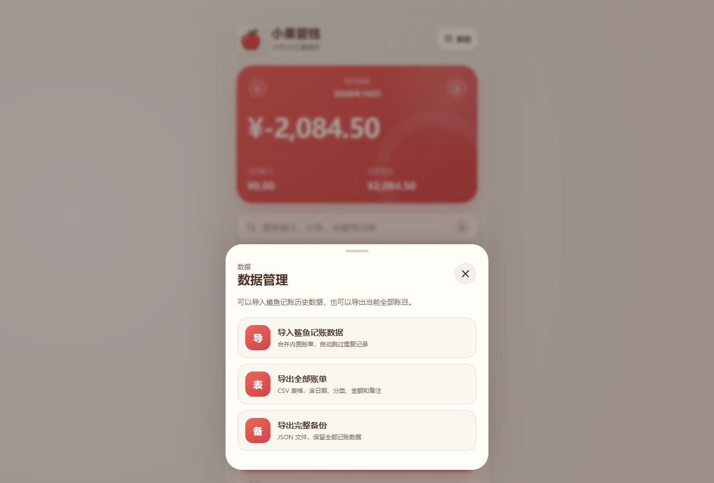
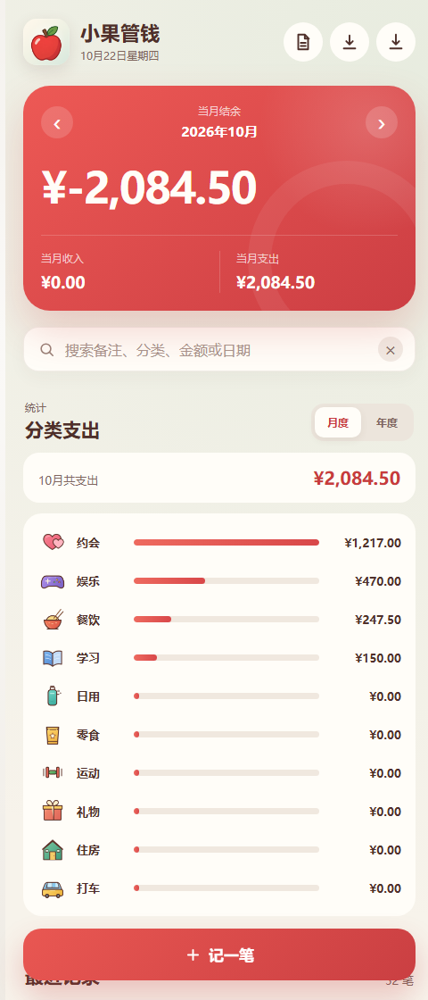

# 小果管钱 · Xiaoguo Ledger

> 一个只把账本留在你自己手机里的极简记账应用 —— Android 原生外壳 + PWA 双端，零后端、零账号、零上传。

[](LICENSE)
[-3ddc84?logo=android&logoColor=white)](android/)
[](web/)
[](web/app.js)

---

## 目录

- [项目简介](#项目简介)
- [界面预览](#界面预览)
- [功能特性](#功能特性)
- [技术架构](#技术架构)
- [目录结构](#目录结构)
- [快速开始](#快速开始)
- [构建签名版 APK](#构建签名版-apk)
- [数据与隐私](#数据与隐私)
- [开发约定](#开发约定)
- [路线图](#路线图)
- [参与贡献](#参与贡献)
- [许可证](#许可证)

---

## 项目简介

小果管钱是一个面向个人日常记账的轻量应用。它最初是为了把一份积累了五年的旧记账软件备份迁移到手机上、并且继续用下去而写的，因此设计上做了两个很明确的取舍：

1. **不做云同步。** 账本只存在设备的 `localStorage` 里，App 本身不发起任何出站网络请求。
2. **不做重前端。** 界面是原生 HTML/CSS/JavaScript，没有框架、没有打包器、没有 `node_modules`，打开就能改。

Android 端是一个约 270 行的 `WebView` 外壳：它把前端资源从 APK 的 `assets/` 里以 https 伪域名的方式提供给 WebView，让同一份前端代码既能作为网页运行，也能作为 APK 离线运行。

## 界面预览

| 分类支出统计 | 历史账目搜索 |
| :---: | :---: |
|  |  |

| 数据管理 | 分类映射预览 |
| :---: | :---: |
|  |  |

## 功能特性

| 能力 | 说明 |
| --- | --- |
| 记一笔 | 支出 / 收入切换，金额、日期、备注、分类四要素 |
| 十个支出分类 | 餐饮、日用、零食、运动、娱乐、约会、学习、礼物、住房、打车 |
| 月度视图 | 左右切换月份，卡片显示当月收入 / 支出 / 结余 |
| 月份选择器 | 直接跳到任意年月，不用一格格翻 |
| 全历史搜索 | 按备注、分类、金额或日期检索任意一笔账，结果分页加载 |
| 分类统计 | 按「本月 / 本年」聚合各分类支出，横向条形对比 |
| 单笔删除 | 列表内直接删除，无需进详情页 |
| 本地持久化 | 刷新、锁屏、重开 App 数据都在 |
| 完整导出 | 一键导出 UTF-8 CSV（Excel/WPS 可直接打开）与 JSON 完整备份 |
| 合并导入 | 导入 JSON 时按记录 `id` 去重，重复导入不会产生重复账目 |
| 可安装 | PWA 可添加到手机主屏幕，支持离线打开 |
| 历史账单迁移 | 内置带分类映射与日期修正的导入通道，用于承接旧软件导出的数据 |

## 技术架构

```
┌─────────────────────────── Android APK ───────────────────────────┐
│  MainActivity (Java)                                              │
│    ├─ WebView + WebSettings（禁用文件访问 / 混合内容 / 缩放）      │
│    ├─ LocalAssetClient：拦截 https://appassets.local/*            │
│    │     └─ getAssets().open("www" + path)  → 本地资源直出         │
│    └─ DownloadBridge (@JavascriptInterface "XiaoguoAndroid")      │
│          └─ MediaStore（API 29+）/ 公共 Downloads 目录（API ≤28）  │
│                              ▲                                    │
│                    window.XiaoguoAndroid.saveToDownloads()        │
└──────────────────────────────┼────────────────────────────────────┘
                               │  同一份前端资源
┌──────────────────────────────┴────────────────────────────────────┐
│  web/  （纯静态：index.html + styles.css + app.js + sw.js）        │
│    ├─ 状态：localStorage["xiaoguo-ledger-transactions-v1"]        │
│    ├─ 渲染：render() → 汇总卡片 / 列表 / 分类统计                  │
│    └─ 导出：CSV（UTF-8 BOM）/ JSON，Web 端走 Blob 下载             │
└───────────────────────────────────────────────────────────────────┘
```

几个实现上的关键点：

- **同一份前端，两种宿主。** `web/` 与 `android/app/src/main/assets/www/` 内容同源（后者不含 `server.js`、`README.md` 这两个仅开发用的文件）。改完前端后用 `node scripts/sync-web-assets.mjs` 同步。
- **用 https 伪域名而不是 `file://`。** `shouldInterceptRequest` 拦截 `appassets.local` 的请求并从 `assets` 读取字节，既拿到了正常的同源语义，又避免了 `file://` 下 `fetch()` 被 CORS 拦掉的问题。
- **导出走原生桥接。** WebView 里点「导出」时，前端把内容编码成 Base64 传给 `XiaoguoAndroid.saveToDownloads()`，由 Java 侧写入 `Downloads` 目录，避开 WebView 下载管理器的机型差异。
- **没有依赖注入、没有构建步骤。** 改 `web/app.js` 保存刷新即生效；Android 工程直接 `gradlew assembleDebug`。

更细的模块划分与数据流见 [docs/架构说明.md](docs/架构说明.md)。

## 目录结构

```
.
├── android/                        Android Studio 工程（可直接 Open）
│   ├── app/
│   │   ├── build.gradle            应用配置、签名配置（读取 keystore.properties）
│   │   └── src/main/
│   │       ├── AndroidManifest.xml 权限、启动 Activity
│   │       ├── java/com/xiaoguo/ledger/MainActivity.java
│   │       ├── assets/www/         前端资源（由 web/ 同步而来）
│   │       └── res/drawable/app_icon.png
│   ├── gradle/wrapper/             Gradle Wrapper（8.9）
│   ├── build.gradle / settings.gradle
│   └── keystore.properties.example 签名配置模板
├── web/                            可独立运行的 PWA 版本
│   ├── index.html / styles.css / app.js
│   ├── manifest.webmanifest / sw.js
│   ├── server.js                   本地静态服务器（仅开发用）
│   ├── assets/{icons,categories}/  图标资源
│   └── imports/shark-ledger.json   ⚠️ 演示数据（合成，125 条）
├── docs/
│   ├── screenshots/                界面截图
│   ├── 架构说明.md
│   ├── 数据格式.md
│   └── 开源发布指南.md             发布、签名、合规检查清单
├── assets/icons/                   1024px PNG / 512px PNG / SVG 图标源文件
├── scripts/
│   ├── gen-demo-ledger.mjs         生成合成演示数据（固定种子，可复现）
│   └── sync-web-assets.mjs         web/ → android/app/src/main/assets/www/
├── .github/workflows/android-build.yml
├── CHANGELOG.md / CONTRIBUTING.md / SECURITY.md
└── LICENSE
```

## 快速开始

### 网页版（零依赖，最快）

```bash
cd web
node server.js
# 浏览器打开 http://127.0.0.1:4173/
```

想看带演示账目的界面，加 `?demo=1`：

```text
http://127.0.0.1:4173/?demo=1
```

也可以用任何静态服务器托管 `web/` 目录（例如 `python -m http.server`）。`server.js` 只是为了避免 `file://` 协议下的 CORS 限制，没有业务逻辑。

### Android 版

环境要求：Android Studio（Ladybug 或更新）、JDK 17、Android SDK 35。

```bash
# 用 Android Studio 直接 Open 仓库里的 android/ 目录，等待 Gradle 同步
# 或者命令行构建调试包：
cd android
./gradlew assembleDebug          # Windows: gradlew.bat assembleDebug
```

产物：`android/app/build/outputs/apk/debug/app-debug.apk`

首次启动时，App 会自动合并 `assets/www/imports/shark-ledger.json` 中的演示账目，方便直接看到有数据的界面。想从空白开始，删掉该文件后重新构建即可。

## 构建签名版 APK

仓库**不包含**任何签名密钥。正式签名需要你自备 keystore：

```bash
cd android
keytool -genkeypair -v -keystore my-release.keystore \
  -alias xiaoguo -keyalg RSA -keysize 2048 -validity 10000
cp keystore.properties.example keystore.properties   # 填入口令
./gradlew assembleRelease
```

`app/build.gradle` 只在 `keystore.properties` 存在时才挂载 `release` 签名配置；文件缺失时 `assembleRelease` 产出未签名包，`assembleDebug` 使用 Android 默认调试密钥，因此克隆下来即可直接构建，无需任何密钥。

> ⚠️ 一旦发布过签名版本，后续升级必须使用**同一个** keystore，否则系统会拒绝覆盖安装。请把 keystore 与口令保存在仓库之外的地方（详见 [SECURITY.md](SECURITY.md)）。

## 数据与隐私

- **存储位置**：全部账目存在设备本地 `localStorage`，键名为 `xiaoguo-ledger-transactions-v1`。清除应用数据或卸载会一并删除，请定期导出备份。
- **无网络传输**：前端没有任何指向外部域名的 `fetch` / `XMLHttpRequest`。APK 声明的 `INTERNET` 权限仅为 WebView 以 https 方案加载本地资源而保留。
- **导出**：`数据 → 导出全部账单` 生成带 BOM 的 UTF-8 CSV；`导出完整备份` 生成含全部字段的 JSON。
- **仓库内的账目文件是假数据**。`web/imports/shark-ledger.json` 由 `scripts/gen-demo-ledger.mjs` 以固定种子生成，共 125 条合成记录（2026-07-01 ~ 2026-10-22），金额、备注、分类均为随机组合，与任何真实用户无关。重新生成：

  ```bash
  node scripts/gen-demo-ledger.mjs            # 覆盖 web/imports/shark-ledger.json
  node scripts/sync-web-assets.mjs            # 再同步进 android assets
  ```

数据结构说明见 [docs/数据格式.md](docs/数据格式.md)。

## 开发约定

- 前端改动：直接编辑 `web/` 下的文件，然后 `node scripts/sync-web-assets.mjs` 同步到 Android。
- 不要手改 `android/app/src/main/assets/www/`，它由脚本单向同步。
- 演示数据只允许由生成脚本产出，不接受手工编辑或真实账单。
- 提交前跑一遍自检：

  ```bash
  node scripts/check-repo.mjs     # 检查敏感文件、真实数据残留
  ```

## 路线图

- [ ] 按月 / 按分类的 CSV 导出筛选
- [ ] 账单编辑（当前仅支持新增与删除）
- [ ] 深色模式
- [ ] 多账本（例如「个人」「家庭」分离）
- [ ] 数据导出到用户指定的目录（SAF）

## 参与贡献

欢迎 Issue 与 PR。提交前请先读 [CONTRIBUTING.md](CONTRIBUTING.md)，并注意：**不要在 Issue、PR 或截图里附带真实账目**。

## 许可证

[MIT](LICENSE) © 2026 chengxi-labs

图标与截图随仓库以 MIT 许可一同分发。项目名称与图标中的「小果」为作者个人标识，fork 后请替换为你自己的名称与图标。
